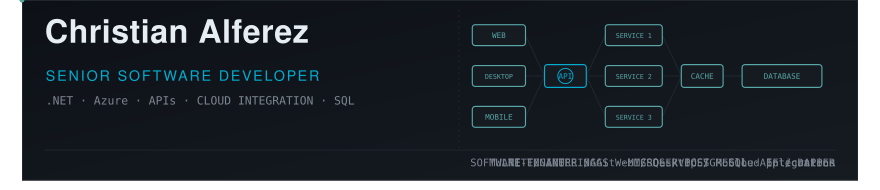

    

    
    
    
    
    
    

Software developer with over 8 years of experience building, integrating, and maintaining web applications and business systems. I work across the stack, with a focus on reliable APIs, cloud-based solutions, and clear, maintainable code.

## What I work on

- Backend services and RESTful/OData APIs with C#, ASP.NET Core, and .NET
- Web applications with JQuery, Angular, TypeScript, and JavaScript
- Azure solutions, including Azure Functions, Service Bus, App Services, and Azure SQL
- API integrations, asynchronous processing, and multi-tenant systems
- Automated testing, CI/CD, and application monitoring

## Technologies

**Languages & frameworks:** C#, .NET, ASP.NET Core, ASP.NET MVC/API, Entity Framework Core, Dapper, VB.NET, Javascript, JQuery, Angular, TypeScript, Python  
**Cloud & DevOps:** Microsoft Azure, Azure DevOps, CI/CD, Kubernetes, Argo CD, Grafana  
**Data & testing:** SQL Server, PostgreSQL, unit and integration testing, Postman, Newman, SonarQube  
**Tools:** Git, Hangfire, SignalR, OData, GitHub Copilot, Claude Code

## Connect

- [LinkedIn](https://www.linkedin.com/in/cralferez/)
- [Email](mailto:christianralferez@gmail.com)
